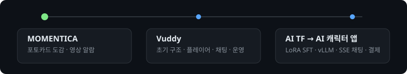

  

신규 앱의 구조 설계부터 출시와 운영까지 맡아 왔으며, Jetpack Compose 기반 멀티모듈 구조와 
인증, 미디어 플레이어, 실시간 채팅, 결제 등 핵심 기능의 설계와 구현을 담당했습니다.

[Portfolio](https://evergreentree97.github.io) | [Tech Blog](https://velog.io/@evergreen_tree)

 

  

 

Claude Code와 Codex, 역할별 에이전트를 업무 전반에 활용하고,
반복 절차는 [K-Humanizer](https://github.com/evergreentree97/K-Humanizer) 같은 Agent Skill로 만들어 재사용합니다.
AI가 만든 결과는 코드 리뷰와 자동 테스트, 스크린샷 테스트, 휴먼 리뷰로 검증합니다.

[EasyShimmerCompose](https://github.com/evergreentree97/easy-shimmer-compose) | [K-Humanizer](https://github.com/evergreentree97/K-Humanizer)
