# 안녕하세요, 최상록입니다

Kotlin으로 앱을 만들어요. LLM을 학습시키거나, 개발할 때 쓸 도구를 만들기도 해요.

롤과 밴드 음악을 좋아해요. 키보드를 연주하고, 클라이밍도 해요.

## 만든 것들

[EasyShimmerCompose](https://github.com/evergreentree97/easy-shimmer-compose)는 Compose 화면에 shimmer 효과를 붙이는 라이브러리예요.

[K-Humanizer](https://github.com/evergreentree97/K-Humanizer)는 AI가 쓴 한국어 문장을 자연스럽게 다듬는 Agent Skill이에요.

[포트폴리오](https://evergreentree97.github.io/) / [블로그](https://velog.io/@evergreen_tree)
