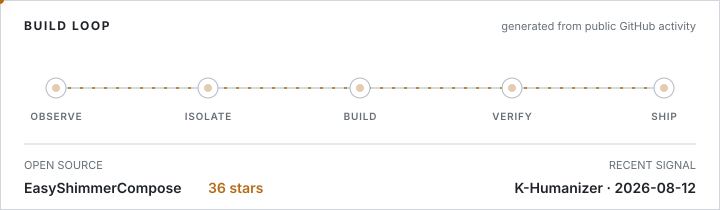

  

3년차 Android Engineer입니다. 신규 앱의 구조 설계부터 출시와 운영까지 맡아 왔으며, 
Jetpack Compose 기반 멀티모듈 구조와 인증, 미디어 플레이어, 실시간 채팅, 결제 등 
핵심 기능의 설계와 구현을 담당했습니다.

[Portfolio](https://evergreentree97.github.io) | [Tech Blog](https://velog.io/@evergreen_tree)

 

  

- **MOMENTICA**: 포토카드 도감과 영상 알람 개발
- **Vuddy**: 신규 앱의 초기 구조와 공통 기반부터 미디어 플레이어, Sendbird 채팅, QA 배포와 출시 후 운영까지 담당
- **사내 AI TF**: 캐릭터 대화 모델의 데이터 구성, LoRA 기반 SFT, 자동 평가와 vLLM 서빙. 내부 평가 85/100과 팀의 실제 대화 심사를 거쳐 프로덕션 적용 가능한 모델로 선정
- **AI 캐릭터 앱**: 해당 모델을 사용하는 신규 앱에서 SSE 기반 채팅, 결제와 광고 주도

 

### AI와 함께 일하는 방식

Claude Code와 Codex, 역할별 에이전트를 업무 전반에 활용합니다.
저장소 구조와 코드 규칙, 완료 조건은 프로젝트 지침으로 관리하고,
반복 절차는 Agent Skill과 개발 도구로 만들어 재사용합니다.
업무에서 사용하던 한국어 문체 교정 규칙도 [K-Humanizer](https://github.com/evergreentree97/K-Humanizer)라는 Agent Skill로 정리해 공개했습니다.

AI가 만든 결과는 작업 유형에 따라 검증합니다.

| 대상 | 검증 |
|---|---|
| 코드 | 리뷰와 자동 테스트 |
| Android 기능 | 별도 테스트 빌드와 실제 기기 확인 |
| 모델 | 자동 평가와 실제 휴먼 리뷰 |

 

<picture>
  <source media="(max-width: 600px) and (prefers-color-scheme: dark)" srcset="./assets/profile-signals-mobile-dark.svg">
  <source media="(max-width: 600px) and (prefers-color-scheme: light)" srcset="./assets/profile-signals-mobile-light.svg">
  <source media="(prefers-color-scheme: dark)" srcset="./assets/profile-signals-dark.svg">
  <source media="(prefers-color-scheme: light)" srcset="./assets/profile-signals-light.svg">
  
</picture>

[EasyShimmerCompose](https://github.com/evergreentree97/easy-shimmer-compose) | [K-Humanizer](https://github.com/evergreentree97/K-Humanizer)
